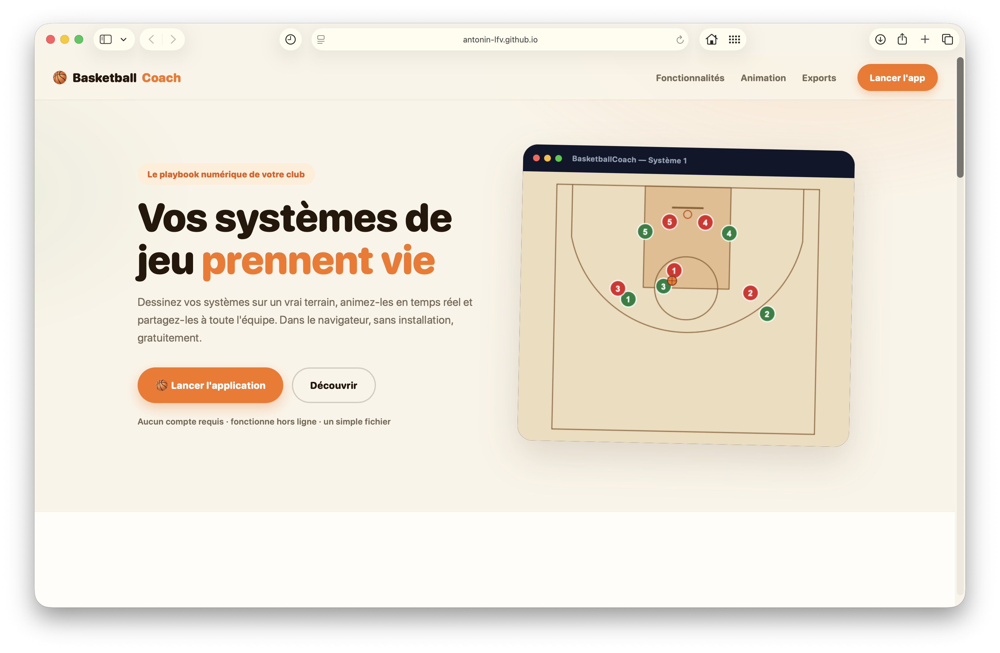
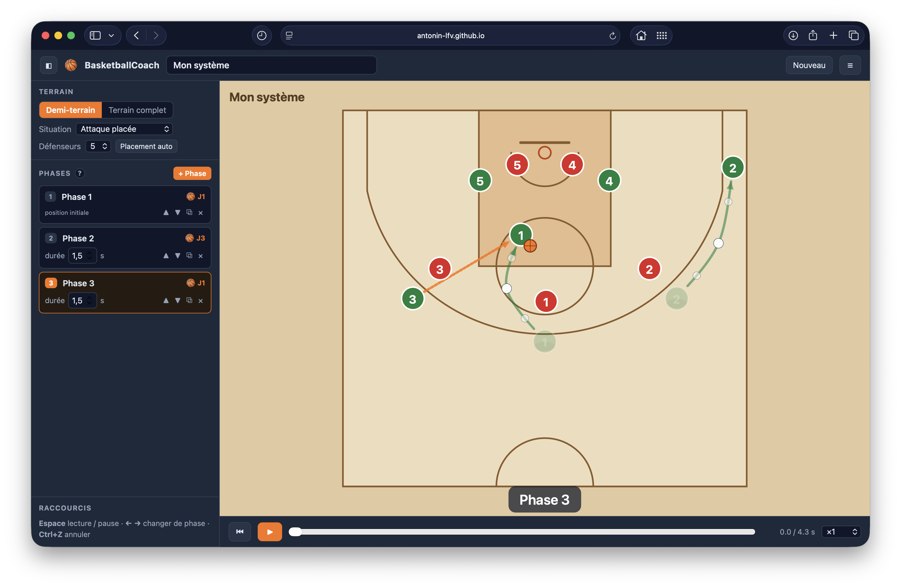

# BasketballCoach

BasketballCoach est un outil web ultra simple pour dessiner, animer et exporter des systèmes de jeu de basketball.

Le projet tient volontairement en deux fichiers HTML : une landing page et un éditeur. Pas de backend, pas de compte, pas de base de données, pas de build.

<p align="center">
  
</p>

<br>

<p align="center">
  
</p>

## Fonctionnalités

- Création de systèmes phase par phase.
- Déplacement des joueurs directement sur le terrain.
- Gestion du ballon : porteur, passe et tir.
- Défenseurs optionnels avec placement automatique.
- Écrans, trajectoires courbes et animation de lecture.
- Demi-terrain ou terrain complet.
- Sauvegarde automatique locale dans le navigateur.
- Import/export JSON.
- Export PNG par phase.
- Export planche imprimable / PDF.
- Export vidéo MP4/WebM selon le navigateur.

## Démo Locale

Le site peut être ouvert directement avec `index.html`. Pour éviter les petites différences entre navigateurs, le plus propre est de servir le dossier :

```bash
python3 -m http.server 8080
```

Puis ouvrir :

```text
http://localhost:8080
```

## Données

BasketballCoach ne stocke rien sur un serveur. Le système courant est sauvegardé dans `localStorage`, puis peut être conservé ou partagé via export JSON.
